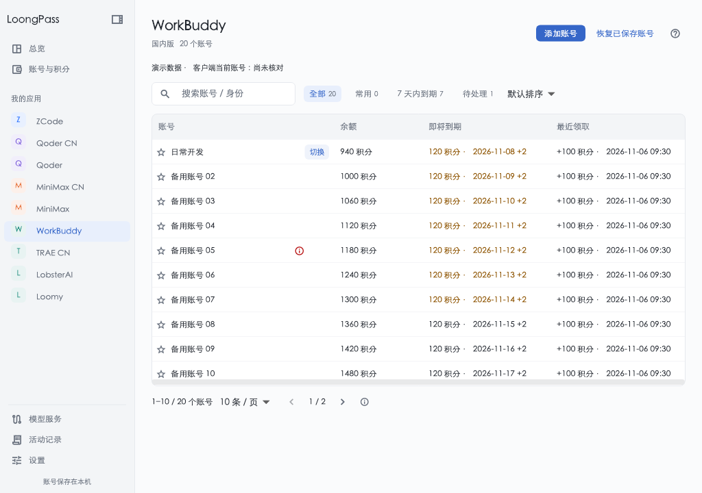

<div align="center">


# LoongPass

### 把 AI 账号、免费奖励与积分到期放在一起

[](https://github.com/SailingLoong/LoongPass/releases/latest)

[](https://github.com/SailingLoong/LoongPass/releases)
[](https://flutter.dev)
[](LICENSE)


[官方网站与下载](https://loongpass.com) · [更新记录](https://github.com/SailingLoong/LoongPass/releases) · [问题反馈](https://github.com/SailingLoong/LoongPass/issues)

</div>

## 它替你做什么

多个 AI 平台、国内与海外版本、不同账号的余额和到期时间，集中放进同一个桌面工作区。

- **多账号授权与恢复**。通过平台官方页面登录，核对账号身份后保存，重启继续使用。
- **免费奖励辅助领取**。检查平台实际开放的签到或活动，记录发送状态和官方回执，保留未知结果以防重复提交。
- **余额与到期查看**。按平台官方单位展示余额、最近到期批次及剩余额度，同时保留查询时间。
- **紧凑账号工作区**。支持搜索、筛选、分页、常用账号和平台排序，并提供跨平台总览及活动记录。
- **签名应用更新**。独立设置辅助检查下载与 Beta 更新渠道，按所选渠道获取后续版本。



界面示意由实际 Flutter 组件渲染，账号与数值均为虚构数据。

## 三分钟上手

1. 从官网或 GitHub Release 下载对应系统的安装包。
2. 在侧栏选择平台及地区，点击授权并在官方页面完成登录。
3. 核对身份并保存账号，再查看余额、到期信息与已确认领取记录。
4. 按账号开启辅助任务，保持 LoongPass 运行。重启后会恢复已保存账号。

国内版与海外版使用各自的官方授权入口，账号、凭据和领取记录分别保存。奖励开放时间、账号及设备资格、最终发放均以平台官方响应为准。

## 安装

| 系统 | 安装包 | 使用方式 |
| --- | --- | --- |
| macOS 12 及以上 | [Universal ZIP](https://github.com/SailingLoong/LoongPass/releases/latest/download/LoongPass-macOS-universal.zip) | 包含 Apple Silicon 和 Intel 架构，解压后将 LoongPass.app 放入应用程序目录 |
| Windows 10 / 11 x64 | [安装版](https://github.com/SailingLoong/LoongPass/releases/latest/download/LoongPass-Windows-x64-Setup.exe) | 按当前用户安装 |
| Windows x64 | [便携 ZIP](https://github.com/SailingLoong/LoongPass/releases/latest/download/LoongPass-Windows-x64.zip) | 完整解压后运行 LoongPass.exe，保留同目录 DLL 和 data 文件夹 |

每个 Release 附带 `SHA256SUMS` 与 `SOURCE_COMMIT`，用于核对安装包和源码版本。Windows 安装版与便携包共用用户数据目录，应用内更新使用安装程序。

当前 macOS 包使用本地签名，尚未进行 Developer ID 公证。Windows 包尚未配置 Authenticode 发布者签名。应用更新包另有发布密钥签名，由原生更新器验证。实际设备与功能验收范围记录在 [VALIDATION.md](VALIDATION.md)。

## 支持的平台

| 平台 | 授权与账号 | 奖励及积分 |
| --- | --- | --- |
| WorkBuddy | 官方授权、多账号保存，macOS 支持官方客户端账号切换 | 签到、余额及领取记录 |
| MiniMax CN / MiniMax | 国内与海外入口独立 | 签到、余额、奖励批次与到期信息 |
| Qoder CN / Qoder | 国内与海外入口独立，保存设备绑定 | 活动核对、套餐和附加积分、领取记录 |
| TRAE CN | 官方设备身份导入与官网授权 | 余额、领取及到期信息 |
| ZCode 智谱 BigModel | 官方授权、多账号和固定设备绑定 | 官方活动发现、领取、余额与到期批次 |
| Loomy（macOS） | 本人手机号短信验证，多账号保存 | 每日赠送池、余额和领取记录，不反复补充已消耗赠送池 |
| Codex（macOS，待发版） | 官方授权、多账号保存和本机登录切换，保留原项目、对话与设置 | 不提供签到或积分 |

ZCode 授权和请求上下文由原生插件提供。新账号沿用原生设备生成逻辑，重新授权保留已绑定设备；明确换绑时只使用已保存且未占用的设备。个人与团队入口共享同一官方账号的活动领取记录，未知结果不会因换绑或重新添加账号而重置。

TRAE CN 沿用原生插件提供的授权方式和设备身份管理，按授权窗口的提示操作。

Codex 使用已安装官方客户端的登录流程，支持现有文件凭据存储。添加账号不会改变当前登录；切换时正常退出并按需重开官方客户端，延续可核实的本机项目和对话偏好。云端对话、订阅与工作区权限仍属于各自账号。凭据应用与客户端身份核实分别展示，实际验收范围见 [Codex 验证记录](docs/verification/2026-11-07-codex-accounts.md)。

辅助任务在 LoongPass 运行期间执行。账号服务启动后调度首次检查，随后每 15 分钟检查；同时遵循官方活动周期、重试等待与账号开关。各平台的实际能力及待验证项以验收记录为准。

## 应用更新

设置提供两个独立开关。

- **自动检查并预下载更新**。新安装默认开启，已有关闭设置继续保留。检查、下载和准备状态直接显示在页面与侧栏，准备好后点击「重启并更新」即可安装。macOS 也会在退出时安装已准备好的更新。
- **接收 Beta 版更新**。默认关闭。关闭时只接收正式版，开启时也接收测试版。手动检查遵循同一渠道选择。

常规检查和下载不另开更新窗口；安装需要系统授权时仍由操作系统提示。更新按构建号比较版本，并保留本机账号与设置。beta 29 及后续 macOS 版本可通过应用内更新升级。

## 数据与隐私

授权以明文保存在本机应用私有目录。macOS 使用 `~/Library/Application Support/LoongPass`，目录权限 0700、文件权限 0600。Windows 使用 `%APPDATA%\LoongPass`，通过当前用户与 SYSTEM 的私有访问控制保护文件。

保存采用唯一写入者、版本比较、原子替换和读回核对。账号授权发送至对应平台的官方接口。请保管账号目录，提交问题时移除令牌、设备标识及原始认证响应。

积分按官方单位展示。到期明细缺失时显示未知，已发放额度与当前剩余额度分别处理。

最近领取只展示已确认记录，后续领取未确认时保留上次成功。旧记录没有具体时刻时显示时间未知；
领取金额与余额观测分开显示，套餐、附加额度与活动权益按原生数据分别展示，不合并重叠额度。
到期明细展示原生接口可核实的到期时间与剩余量，缺失时显示未知。表格不会因搜索或查看明细而触发签到。

工作区包含总览、全部账号、模型服务、活动记录和设置。侧栏可折叠、调整平台顺序并在重启后恢复；地区标签帮助区分国内外入口。

## Magpie 模型服务

LoongPass 使用固定版本的 Magpie 原生插件宿主和完整上游插件包。原生插件负责授权、续期、模型目录和供应方请求；Magpie 负责客户端协议、模型分组、账号选路与推理恢复。

1. 在各应用页面保存账号，在「模型服务」中启用希望提供给 Magpie 的账号。
2. 打开本机模型服务，点击「连接 Magpie」。应用通过 Magpie 原生命令安装本地插件并保存逐账号授权。
3. 在 Magpie 中为 Claude Code、DeepSeek Harness 等客户端选择模型或原生路由分组，保持 LoongPass 运行。

本机服务监听 `127.0.0.1:3426`。Magpie 只保存逐账号的本地调用授权，供应方凭据由 LoongPass 私有目录内的原生宿主独占管理。撤销、删除或重新授权账号后，旧调用授权失效。旧版自定义 LoongPass 来源在新授权确认、备份成功后通过 Magpie 原生命令移除；只识别地址和旧密钥均匹配的来源。

ZCode 的 `-Trial` 模型仅使用 Start Plan 赠送权益；普通模型沿用上游 `freeFirst`，赠送优先，再使用账号已有套餐，不购买套餐或充值。模型调用采用 Magpie 原生恢复，断流恢复可能额外消耗额度；无需设置旧版要求的禁用重试环境变量。未知签到仍保留待核验记录，不盲目再次领取。

来源锁定、维护方法和兼容补丁见 [原生运行时说明](runtime/README.md)。实际验收记录会区分模拟、构建与真实接入，不由模型目录加载成功推断实际调用成功。

DeepSeek Harness 的父子会话可共用这条模型链路。开启 Agent Teams、选择子 agent 模型，以及为独立 Superagent profile 配置模型，见 [Teams / Superagent 接入指南](docs/dsh-multi-agent.md)。

## 从源码构建

使用`pubspec.yaml` 指定的 Flutter 和锁定依赖。macOS 还需 Xcode 与仓库指定的 Rust 工具链，Windows 还需 Visual Studio 2022 的 C++ 桌面开发工具、CMake、Python、NuGet CLI 与 PowerShell 7。

```bash
flutter pub get --enforce-lockfile
xcodebuild -resolvePackageDependencies -project macos/Runner.xcodeproj -scheme Runner -clonedSourcePackagesDirPath build/macos/SourcePackages
python3 tool/check.py
python3 tool/build_macos_release.py
```

Windows 构建与打包可在 PowerShell 执行。

```powershell
flutter pub get --enforce-lockfile
$env:WINSPARKLE_SDK = Join-Path $env:LOCALAPPDATA 'LoongPass-build-cache\WinSparkle'
if (!(Test-Path $env:WINSPARKLE_SDK)) {
  .\tool\build_winsparkle.ps1 -Destination $env:WINSPARKLE_SDK
}
flutter build windows --release
.\tool\package_windows.ps1
```

安装程序打包使用 Inno Setup 6。正式发布由 GitHub Actions 构建两个平台，检查通过后生成签名更新清单并发布 Release。

WinSparkle SDK 从固定上游提交构建，通过自定义界面桥接复用其检查、下载、签名校验、跳过版本与安装流程。构建输入和 SDK 文件均核对哈希，缓存只保留最终 SDK，编译中间目录完成后清理。macOS 的原生接口检查也可通过 `SPARKLE_FRAMEWORK_ROOT` 复用已校验的同版本 SDK，路径指向 `Sparkle.framework` 所在目录。

## 开源与致谢

LoongPass 以 MIT 许可公开。账号与活动适配参考 LoongPort、workbuddy-switch 和 zcode-switch，并保留原作者声明。第三方组件的来源和许可见 [THIRD_PARTY_NOTICES.md](THIRD_PARTY_NOTICES.md)。
